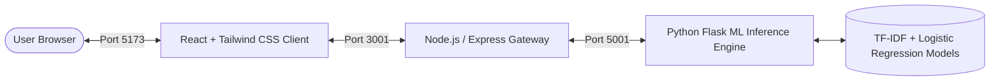

# 🧠 SentimentIQ — AI-Powered Sentiment Analysis Platform

[](https://react.dev/)
[](https://tailwindcss.com/)
[](https://nodejs.org/)
[](https://flask.palletsprojects.com/)
[](https://scikit-learn.org/)
[](LICENSE)

**SentimentIQ** is a modern, high-performance, full-stack web application for sentiment classification. Powered by a pre-trained **TF-IDF + Logistic Regression model** evaluated on the **Sentiment140 dataset (1.6 Million tweets)** achieving **81.58% test accuracy**, SentimentIQ delivers instant sentiment predictions across **Positive**, **Neutral**, and **Negative** classes with probability distributions and confidence scores.

---

## ✨ Features

- **🎯 Tri-Class Sentiment Analysis:** Predicts **Positive**, **Neutral**, and **Negative** sentiments with fine-grained probability calibration.
- **⚡ Real-Time Predictions:** Low-latency ML inference (<50ms average inference time).
- **📊 Probability Breakdown:** Visual progress indicators showing exact percentage distribution across all 3 sentiment classes.
- **🎨 Modern White & Blue Aesthetic:** Clean glassmorphism cards, smooth animations, and responsive mobile-first layout.
- **🕒 Interactive Session History:** Tracks your recent analyses with quick-revisit capability and sentiment tags.
- **📈 Session Statistics:** Live analytics view breaking down positive vs. neutral vs. negative distributions across your session.
- **🚀 One-Click Examples:** Preloaded sample prompts to test positive, neutral, and negative sentiment cases instantly.
- **🔒 Multi-Tier Architecture:** Decoupled React frontend, Node.js/Express API Gateway with rate limiting, and dedicated Python Flask ML service.

---

## 🏗️ System Architecture



| Tier | Technology | Role | Port |
| :--- | :--- | :--- | :--- |
| **Frontend** | React 19, Tailwind CSS v4, Lucide React, Vite | Responsive UI, interactive charts & panels | `5173` |
| **API Gateway** | Node.js, Express, Axios, Morgan, Rate-Limit | Proxy gateway, rate limiting, request validation | `3001` |
| **ML Engine** | Python 3.12, Flask, Scikit-learn, Joblib | Preprocessing, TF-IDF vectorization, Logistic Regression inference | `5001` |

---

## 📁 Repository Structure

```
sentimentiq/
├── client/                     # Frontend Application
│   ├── src/
│   │   ├── components/
│   │   │   ├── AnalyzePanel.jsx # Input textarea, char counter, example chips
│   │   │   ├── Header.jsx       # Top navigation bar
│   │   │   ├── HistoryPanel.jsx # Recent analysis session history
│   │   │   ├── ResultCard.jsx   # Verdict card with probability breakdown
│   │   │   ├── Sidebar.jsx      # Desktop navigation sidebar
│   │   │   └── StatsView.jsx    # Session analytics & distribution bar
│   │   ├── api.js              # Axios service layer
│   │   ├── App.jsx              # Main application shell & router
│   │   ├── index.css            # Tailwind CSS styling & animations
│   │   └── main.jsx             # React entry point
│   ├── index.html
│   ├── vite.config.js
│   └── package.json
│
├── server/                     # API Gateway (Node.js/Express)
│   ├── index.js                # Express app, middleware, proxy routes
│   ├── .env.example            # Environment variables template
│   └── package.json
│
├── inference/                  # Machine Learning Microservice (Flask)
│   ├── models/
│   │   ├── sentiment_model_1_6m.pkl    # Pre-trained Logistic Regression model
│   │   └── tfidf_vectorizer_1_6m.pkl   # Fitted TF-IDF Vectorizer
│   ├── app.py                  # Flask inference API & 3-way calibration
│   ├── preprocess.py           # clean_tweet() text cleaning pipeline
│   └── requirements.txt        # Python dependencies
│
├── .gitignore
└── README.md
```

---

## 🚀 Getting Started

### Prerequisites

- **Node.js** (v18 or higher)
- **Python** (v3.10 or higher)
- **pip** package manager

---

### Step 1: Start the Python ML Inference Service

```bash
cd inference

# Install Python dependencies
pip install -r requirements.txt

# Run the Flask inference server (Port 5001)
python app.py
```

### Step 2: Start the Node.js / Express Server

```bash
cd ../server

# Install npm dependencies
npm install

# Copy environment variables
cp .env.example .env

# Start the Express server (Port 3001)
npm start
```

### Step 3: Start the React Frontend

```bash
cd ../client

# Install npm dependencies
npm install

# Start Vite dev server (Port 5173)
npm run dev
```

### Step 4: Open in Your Browser

Navigate to **[http://localhost:5173](http://localhost:5173)**.

---

## 📡 API Documentation

### 1. Health Check
```http
GET http://localhost:3001/api/health
```

**Response:**
```json
{
  "status": "ok",
  "model_ready": true,
  "accuracy": 81.58,
  "model_type": "TF-IDF + Logistic Regression",
  "training_samples": "1.6M tweets",
  "classes": ["Positive", "Neutral", "Negative"],
  "node_server": "ok"
}
```

---

### 2. Analyze Sentiment
```http
POST http://localhost:3001/api/analyze
Content-Type: application/json

{
  "text": "The package was delivered today at 2 PM."
}
```

**Response:**
```json
{
  "sentiment": "Neutral",
  "confidence": 0.7188,
  "p_positive": 0.2065,
  "p_neutral": 0.7188,
  "p_negative": 0.0747,
  "cleaned_text": "the package was delivered today at pm",
  "word_count": 7
}
```

---

## 🧪 Machine Learning Details

- **Dataset:** Sentiment140 (1,600,000 annotated tweets)
- **Vectorization:** TF-IDF with custom `clean_tweet` preprocessor
- **Algorithm:** Logistic Regression with L2 Regularization
- **Benchmark Accuracy:** 81.58% on test evaluation
- **Preprocessing Pipeline:**
  - Removal of `@mentions`, URLs (`http/https`), special characters
  - Lowercase normalization and contraction resolution
  - Preservation of multi-word contextual sentiment phrases

---

## 👨‍💻 Author

Developed by **Veejeet Singh**  
GitHub: [@VeejeetSingh](https://github.com/VeejeetSingh)

---

## 📄 License

This project is open-source and available under the [MIT License](LICENSE).
